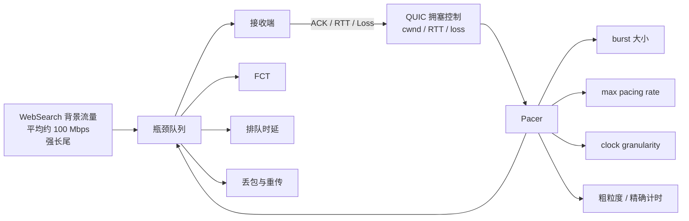
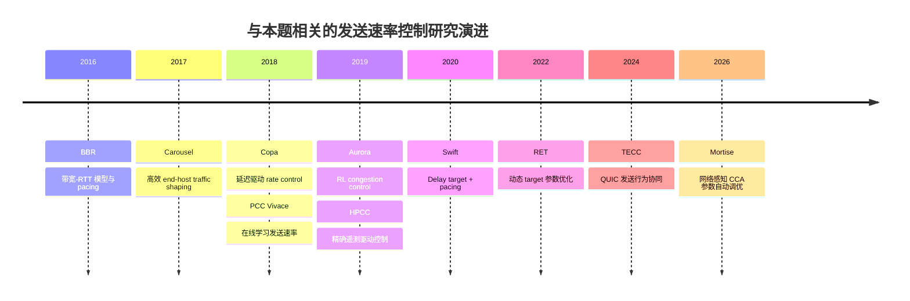
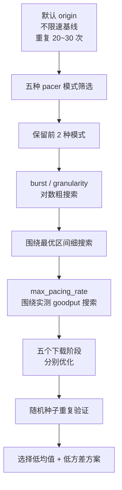

# QUIC 流量整形参数优化的理论研究报告：WebSearch 背景流量下的文件下载完成时间最小化

## 执行摘要

根据附件内容，题目并非真正“未指定”，而可以较明确地重构为：**在 QUIC 文件下载过程中，通过配置发送端流量整形／packet pacing 参数，使下载流在持续存在的 WebSearch 背景流量竞争下尽可能缩短文件下载完成时间（Flow Completion Time, FCT）**，可操作的整形器包括 `token_bucket`、`coarse_grained_rate_based`、`precise_rate_based`、`origin` 混合整形器以及 `leak_bucket`，并且五次文件下载可以分别配置参数

近十年的研究基本形成了一个一致认识：高性能传输并不等价于“尽可能快地连续发包”，更有效的策略是在 **可用带宽利用率、微突发、排队时延、丢包／重传和调度开销** 之间寻找平衡，QUIC 标准本身明确建议对所有在途数据包实施 pacing，因为无间隔突发发送容易造成短时拥塞和丢包，同时 QUIC 允许 pacer 位于拥塞控制器之外，对拥塞控制器产生的发送许可进行进一步调度 citeturn713993search0

结合附件给出的实现约束，本题有一个非常重要的理论性质：附件定义的 `max_pacing_rate` 实际采用

\[
R_{\mathrm{actual}}=\min(R_{\mathrm{CC}},R_{\mathrm{config}})
\]

因此 **pacer 的速率上限无法直接让 QUIC 比拥塞控制器允许的速度更快，只能限速**，有限的 `max_pacing_rate` 只有在它能够减少微突发、丢包、重传或排队振荡时，才可能间接降低 FCT，这意味着搜索重点不应是盲目寻找一个“小的限速值”，而应该优先研究 **burst 大小、时间精度以及何时让 rate cap 失效／生效**

附件中的 WebSearch CDF 采用区间线性插值，按该规则计算得到平均流大小约为 **1.71125 MB**，标准差约为 **3.97 MB**，变异系数约为 **2.32**，说明背景负载具有非常明显的长尾，在这种情况下，平均 100 Mbps 的背景流量并不意味着瞬时负载稳定在 100 Mbps，短流群聚和少量大流都可能产生明显的瞬时带宽竞争，因此 **固定速率整形很可能不如允许有限 burst 的自适应／混合机制**

综合理论、近十年文献以及题目提供的实现，当前最值得优先验证的方案是 **以 `origin` 为主线，保持 `enable_n_in_flight` 类的空闲快速发送机制，采用中等 burst，并将 `max_pacing_rate` 设为不绑定或略高于实测稳定 goodput，再对 `burst_tokens × clock_granularity × rate cap` 做黑盒优化**，`precise_rate_based` 应作为第二候选，用于验证粗粒度调度误差是否真正构成瓶颈，而纯 `leak_bucket` 更适合作为“极平滑发送”的对照组而不是第一候选

更值得注意的是，附件允许针对五次下载分别提交配置，因此这里并不是单一参数优化问题，而可以写成

\[
\min_{\theta_1,\ldots,\theta_5}
\quad
T_{\mathrm{total}}
=
\sum_{i=1}^{5}T_i(\theta_i,B_i,C_i)
\]

如果每次下载的文件大小、背景状态或连接状态存在稳定差异，那么 **五组异构参数通常会优于一套全局参数**，这一点应作为实验阶段的最高优先级优化方向

## 题目重构与理论模型

附件中的背景流量希望长期占用约 100 Mbps，也就是约 **12.5 MB/s**，而流量整形模块中的 `max_pacing_rate` 单位是 **字节/秒而不是 bit/s**，这是实验中非常容易产生数量级错误的一点，例如希望配置 100 Mbps 上限时应使用约 `12_500_000 B/s`，而不是 `100_000_000 B/s`

设瓶颈链路容量为 \(C\)，WebSearch 长期平均负载为 \(B\approx100\text{ Mbps}\)，目标文件大小为 \(S\)，如果暂时忽略公平性、随机排队和传输协议控制，则理想流体模型下目标下载可以获得的剩余容量上界约为

\[
R_{\mathrm{residual}}\leq C-B
\]

对应理论下界

\[
T_{\mathrm{FCT}}\geq\frac{S}{C-B}
\]

但真实 QUIC 环境中速率实际上由拥塞控制窗口、RTT、pacer 以及背景流竞争共同决定，因此更合理的表达是

\[
R(t)
=
\min
\left(
R_{\mathrm{CC}}(t),
R_{\mathrm{pacer}}(t),
R_{\mathrm{available}}(t)
\right)
\]

QUIC RFC 9002 给出的标准 pacing 思路也是根据拥塞窗口和 smoothed RTT 决定发送速率，并指出实际系统中的 packetization、调度延迟和计算开销都会让发送过程偏离理想的均匀 pacing citeturn713993search0turn713993search3

附件 WebSearch 分布尤其值得重视，在按附件描述进行分段均匀插值后，可得到

| 统计量 | 推导结果 | 对优化的含义 |
|---|---:|---|
| 平均流长 | 约 1.711 MB | 平均值被少量大流显著抬高 |
| 中位数 | 约 73 KB 左右 | 绝大多数交互实际上是较短流 |
| 最大流 | 30 MB | 偶发大流可以长期占据瓶颈 |
| 流长标准差 | 约 3.97 MB | 瞬时竞争波动明显 |
| 变异系数 CV | 约 2.32 | 固定 pacing rate 很难同时适应所有时刻 |

这与近年的数据中心研究所采用的 WebSearch workload 特征一致，例如 HPCC 的公开仿真代码明确包含 `WebSearch_distribution.txt`，HPCC、后续公平排队研究和 PowerTCP 等工作仍使用 WebSearch 类负载评价短流 FCT 与网络利用率 citeturn596955search18turn513883search1turn513883search2

## 近十年核心文献与方法图谱

下面优先选择 2016—2026 年间的标准、顶级会议论文、作者技术报告和高质量公开实现，与本题最直接相关的是 packet pacing、rate control、延迟控制、在线优化以及参数自动调优

| method name | year | venue | core idea | performance metrics | pros/cons | code availability | dataset used |
|---|---:|---|---|---|---|---|---|
| BBR | 2016/2017 | ACM Queue / CACM | 根据瓶颈带宽与 RTT 建模，以 pacing 控制发送，而非单纯依赖丢包 | throughput、RTT、bufferbloat | 优点是显式建模 BDP；缺点是与其他流的公平性和参数动态仍复杂 citeturn713993search2turn859677search3 | 有，Google BBR 仓库及 QUIC BBR2 实现 citeturn596955search39 | Google 实网和模拟场景 |
| Carousel | 2017 | ACM SIGCOMM | 使用时间轮／单队列实现高规模 end-host pacing 与 shaping | shaping scalability、CPU overhead、吞吐 | 说明精细 pacing 本身存在明显 CPU 和调度开销；支持数万策略／流 citeturn713993search1turn596955search8 | 未见作者公开完整生产实现 | 数据中心主机流量整形 benchmark |
| Copa | 2018 | NSDI | 以排队时延 \(d_q\) 构造目标发送率 \(1/(\delta d_q)\)，动态权衡吞吐和延迟 | throughput、delay、fairness | 对低队列、高利用率效果好；面对填满缓冲区的 loss-based 流时需特殊机制 citeturn247660search1 | 有作者 CCP 实现 citeturn596955search22 | 模拟、仿真与 Internet path |
| PCC Vivace | 2018 | NSDI | 将发送速率选择建模为在线凸优化，直接根据实测 utility 调整 rate | throughput、latency、loss、convergence | 不依赖固定网络模型，对未知环境适应性强，但需要持续探测 citeturn247660search0 | 有，PCC-Uspace citeturn247660search4 | 多种仿真和网络条件 |
| Aurora | 2019 | ICML | 用强化学习根据 latency gradient、latency ratio、send ratio 调整发送率 | throughput、latency、loss、generalization | 能学习复杂非线性策略，但论文也明确指出 fairness、安全和泛化是部署难点 citeturn307101search0turn247660search6 | 有公开 Gym／测试代码 citeturn307101search0 | Mininet、Pantheon、模拟网络 |
| HPCC | 2019 | SIGCOMM | 利用 INT 精确测量链路负载并快速调节速率 | 相比 DCQCN/TIMELY FCT 最多降低约 95% | 高精度、低队列，但依赖网络遥测，无法直接移植到本赛题 citeturn222482search0 | 有官方模拟器 citeturn596955search1 | WebSearch、数据中心 workload citeturn596955search18 |
| Swift | 2020 | SIGCOMM | 基于精确 RTT／delay target 的 AIMD，并在严重拥塞时结合 pacing | 短 RPC 尾延迟低于约 50 μs，同时接近 100 Gbps/server | 简洁、实际部署；要求较准确的时延测量 citeturn222482search3turn222482search4 | 未见完整生产代码公开 | Google 数据中心生产负载 |
| RET | 2022 | IEEE ICNP | 动态调整 RTT-based CC 的 target delay，避免固定目标过大或过小 | tail latency 最多约为 Swift 的 1/1.5、DCQCN 的 1/3.6 | 直接证明“固定参数并非全局最优”，与本题参数调优逻辑高度相关 citeturn222482search9 | 论文未提供完整生产代码 | 真实 workload 合成流量、testbed、simulation |
| TECC | 2024 | USENIX NSDI | 协调 QUIC tunnel 内外层发送行为并改进反馈 | 仿真平均 FCT 下降约 30%，p99 下降约 53% | QUIC 特异性强，说明发送调度与反馈匹配会显著改变 FCT citeturn222482search8 | 论文系统实现 | 仿真与 Alibaba 大规模 A/B |
| Mortise | 2026 | USENIX NSDI | 根据实时网络状态自动调节规则型拥塞控制参数，而不是固定 heuristic | 实际文件下载 QoE 最多提高约 73% | 与本题最接近，直接支持“参数应随网络状态改变”的假设 citeturn625713search0 | 有公开原型和下载 workload citeturn625713search4 | emulation + production file download traces |

其中 Carousel DOI 为 `10.1145/3098822.3098852` citeturn859677search8，BBR CACM 版本 DOI 为 `10.1145/3009824` citeturn859677search3，Copa ACM 版本 DOI 为 `10.1145/3232755.3232783` citeturn859677search5，HPCC DOI 为 `10.1145/3341302.3342085` citeturn222482search0，Swift DOI 为 `10.1145/3387514.3406591` citeturn222482search5，Aurora 对应 arXiv `1810.03259` citeturn307101academia8

从演进关系上看，近十年的研究方向非常清晰

因此本题不应被简单理解为“比较五种限流器”，更合适的研究视角是 **在一个不可修改拥塞控制器的 QUIC 黑盒上，再叠加一个低维可调发送调度器，并通过实测 FCT 学习其最优控制参数**，这一思路与 PCC Vivace 的 performance-oriented optimization 以及 Mortise 的 network-aware parameter tuning 最为接近 citeturn247660search0turn625713search0

## 对五类流量整形器的理论分析

### `origin` 混合整形器

从附件实现来看，`origin` 同时具有初始 burst、速率 pacing 和无在途包时的快速放行机制，因此最接近实际生产系统中常用的“允许有限 burst + 长期平滑发送”设计，QUIC RFC 同样并不要求完美等间隔发送，而是允许短时间内由于调度与 packetization 偏离理想 pacing citeturn713993search0

对最小化 FCT 而言，它的优势是文件开始下载或 ACK 突然释放窗口时可以快速填充 BDP，而不会像纯漏桶一样从第一个包开始就强制固定节奏；风险则是 `burst_tokens` 太大时产生 microburst，导致背景短流共同排队甚至触发 loss

因此可提出近似最优条件

\[
B_{\mathrm{burst}}\approx
\min
\left(
\alpha\cdot BDP,
B_{\mathrm{queue-safe}}
\right)
\]

其中 \(\alpha\) 不宜固定，而应通过实验估计，在本题无法获得 BDP 和 buffer 大小时，更适合直接对 `burst_tokens` 做对数尺度搜索

### `precise_rate_based` 与 `coarse_grained_rate_based`

理论上的目标包间隔为

\[
\tau=\frac{L}{R}
\]

如果 QUIC 包大小约为 1200 B，目标速率为 100 Mbps，则理想包间隔只有约

\[
\tau
=
\frac{1200\times8}{100\times10^6}
\approx96\ \mu s
\]

这说明在百 Mbps 或更高速率下，毫秒级时间误差已经足以让多个理论上应分散发送的数据包聚集在同一个调度窗口内，RFC 9002 同样指出调度延迟和计算效率会导致短时间尺度上的 pacing 偏离 citeturn713993search0

因此，如果实验发现 coarse 模式存在明显的周期性 burst 或 FCT 抖动，`precise_rate_based` 很可能获得收益；反之，如果 CPU／timer 调用已经成为发送瓶颈，更精确的计时可能反而降低吞吐，Carousel 的核心结论之一正是高精度 end-host shaping 并非没有系统开销，调度机制必须考虑可扩展性 citeturn713993search1turn596955search8

### `token_bucket`

令牌桶最大的理论优势是 **允许长期平均速率受到限制，同时保留短时间 burst**，这正适合 WebSearch 背景负载存在空隙与突发的环境

但附件实现按照“每个数据包消耗一个 token”而非按照字节数消耗 token，因此其真实字节速率近似为

\[
R
\approx
\frac{N_{\mathrm{token}}\cdot E[L]}{\Delta t}
\]

当 QUIC 包大小发生变化时，配置相同 token refill rate 不一定对应相同的 byte rate，这会给参数解释带来噪声，因此 token bucket 更适合做经验优化，而不是仅根据理论带宽直接计算参数

### `leak_bucket`

漏桶最稳定，因为输出趋向固定 cadence，但这也正是它对 FCT 的最大限制，当背景 WebSearch 流量短暂减少时，漏桶无法像 token bucket 或 `origin` 一样利用瞬时空闲容量，因此理论上更可能牺牲下载完成时间换取低 jitter 和低 burst

不过，如果瓶颈队列极小，且 loss/retransmission 是当前基线的主要问题，那么漏桶仍可能反超其他模式，这也是必须保留它作为实验对照组的原因，QUIC RFC 明确将 leaky-bucket 作为一种可能的 pacing 实现策略 citeturn713993search0

## 优化方向与研究优先级

本题最值得做的并不是把所有参数暴力枚举，而是把问题分成 **模式选择、burst 优化、rate-cap 优化、时间精度优化、五阶段个性化** 五层，其中现代研究对动态参数调节的支持尤其强，RET 证明固定 delay target 可能造成低利用率或高延迟，Mortise 更进一步证明规则型传输算法的最优参数依赖实时网络状态，并在文件下载场景获得显著 QoE 改善 citeturn222482search9turn625713search0

1. **最高优先级：`origin` + 五次下载分别调参**，不要默认五个子目录使用相同配置，先测试每次下载独立 FCT，若不同阶段存在稳定差异，就分别优化 \(\theta_1,\ldots,\theta_5\)，这是附件接口天然提供而多数普通 QUIC benchmark 不具备的自由度

2. **高优先级：优化 `burst_tokens`，而不是先限速**，建议从 `{1, 2, 4, 8, 16, 32, 64}` 这样的对数网格开始，因为 rate cap 只能降低拥塞控制器允许的速率，而 burst 直接控制微突发与快速填充 BDP 的权衡，RFC 9002 也明确警告无间隔 burst 会造成短期拥塞与丢包 citeturn713993search0

3. **高优先级：`max_pacing_rate=0` 或非绑定值作为主基线**，先测得无 cap 的 goodput \(G_0\)，然后只测试大约 `0.8G0、1.0G0、1.2G0、1.5G0、unlimited` 一类范围，如果低 cap 能赢，说明基线存在明显的 loss／queue penalty，而不是因为“限速本身提高了带宽”

4. **中高优先级：搜索 `clock_granularity`**，推荐对数尺度而非线性尺度，例如从几十微秒到 1 ms，重点观察 FCT 方差而不只看均值，如果 granularity 越小 FCT 持续下降，则进一步比较 precise 模式；如果到某一点停止改善，则可能已经进入 timer／CPU 开销主导区域，Carousel 和 Swift 都说明高精度 pacing／timestamp 会带来系统实现成本 citeturn713993search1turn222482search3

5. **中优先级：用黑盒优化代替全排列**，变量同时包含 categorical mode 和多个整数参数，非常适合 TPE、Bayesian optimization 或 CMA-ES，对于每组配置以多次重复实验得到 \(E[T]\) 和 \(\operatorname{Std}(T)\)，目标函数可以设计为 \(J=E[T]+\lambda\operatorname{Std}(T)\)，从而避免得到仅靠随机背景流量“偶然刷快”的脆弱参数，PCC Vivace 和 Mortise 都表明直接基于实测 utility 调节参数是可行路线 citeturn247660search0turn625713search0

6. **研究型方向：状态感知动态 pacing**，如果后续允许修改代码，可以使用 RTT gradient、loss、bytes-in-flight 和 goodput 作为状态，实时切换 burst 和 rate cap，这与 Aurora 的状态设计、Copa 的 queueing-delay feedback 以及 Mortise 的 network-aware tuning 在理论上高度一致 citeturn247660search1turn247660search6turn625713search0

目前最大的开放问题不是“哪个桶最好”，而是隐藏的瓶颈容量 \(C\)、实际 QUIC congestion controller、buffer 大小、RTT、五个文件大小以及背景流量随机种子是否固定，如果这些因素不可见，那么最优策略应倾向 **鲁棒的 empirical optimization**，而不是依赖单一解析公式

## 实验验证设计与资源估算

评价指标应以赛题实际目标为中心，主指标直接使用每次文件的 **FCT** 和五次下载的总时间，同时计算 goodput

\[
G_i=\frac{S_i}{T_i}
\]

如果日志可以获得更底层信息，应同时记录 retransmission、loss、RTT、bytes-in-flight 和 CPU 使用率，因为“更快”的配置可能来自真正提高可用带宽，也可能只是以更大的队列和丢包风险换取一次偶然优势，现代 congestion-control 研究普遍同时评价 throughput、delay、loss 和 FCT，而不是只观察吞吐量 citeturn247660search0turn307101search0turn222482search0

推荐的实验流程为

一个实用的第一阶段参数空间可以设成

| 参数 | 第一轮建议搜索空间 | 理论目的 |
|---|---|---|
| `pacer_mode` | 5 种模式 | 模式筛选 |
| `burst_tokens` | 1, 2, 4, 8, 16, 32, 64 | BDP 填充与 microburst 权衡 |
| `clock_granularity` | 10, 25, 50, 100, 250, 500, 1000 μs | pacing 精度与调度开销 |
| `max_pacing_rate` | unlimited + 相对 \(G_0\) 的 0.8×、1.0×、1.2×、1.5× | 判断是否存在过度 burst／loss |
| token refill interval | 对数尺度搜索 | 控制 token cadence |
| token/bucket capacity | 与 burst 联动搜索 | 控制瞬时发送能力 |
| `enable_n_in_flight` | 0 / 1 | 判断 idle restart 是否造成 stall 或 burst |

不建议做完整笛卡尔积，例如仅 `7 × 7 × 5 × 5` 就有 1225 组组合，而且每组还需要重复实验，更适合先 screening，再做局部 Bayesian/TPE 搜索

在资源方面，本题基本不需要 GPU，主要成本是仿真运行时间和重复次数，假设单次完整五文件评估耗时约 1—5 分钟，则 200 次实验约需要 **3—17 小时单机串行时间**，500 次约需要 **8—42 小时**，日志数据通常只需数百 MB 到数 GB，这些数字是基于单次运行时间假设的工程估算而非赛题已知条件

若只做竞赛导向优化，可在约 **2—4 天** 内完成 mode screening、粗搜索和局部细化；若希望形成有理论价值的研究工作，则建议增加不同 background load、RTT、buffer、瓶颈容量和 WebSearch 随机种子的 robustness experiment，实验周期扩展至约 **1—2 周**

## 结论与原始研究入口

从现有理论和文献来看，这个题目的最优突破点并不在于设计新的拥塞控制器，而在于 **利用已有 QUIC CC 之上的 pacing 自由度，把一个固定 heuristic 参数问题转化为低维、可重复测量的黑盒控制优化问题**

QUIC RFC 已经给出了 pacing 的理论必要性，并明确说明 burst、调度延迟和 pacer／CC 交互会影响真实发送行为 citeturn713993search0，Carousel 说明高精度 shaping 的系统开销不可忽略 citeturn713993search1，Copa 与 Swift 说明 delay feedback 对高利用率低排队控制有效 citeturn247660search1turn222482search3，PCC Vivace 与 Aurora 表明发送速率可以通过数据驱动方法直接优化 citeturn247660search0turn307101search0，而 2026 年 Mortise 已经进一步证明 **动态调整传统 CCA 参数本身就能够在真实文件下载服务中获得显著收益** citeturn625713search0

针对本赛题，最有希望的具体路线因此是 **`origin` → burst 优化 → granularity 优化 → 非绑定或轻度绑定 rate cap → 五次下载独立参数化 → 黑盒自动搜索 → 多次随机重复验证**，其中第一批实验最应该回答三个问题：有限 `max_pacing_rate` 是否真的减少重传、`burst_tokens` 的最优区间在哪里、以及 `precise_rate_based` 的时间精度收益能否超过它的调度开销

原始论文与标准入口包括 RFC 9002 citeturn713993search0、Carousel SIGCOMM 2017 `doi:10.1145/3098822.3098852` citeturn859677search8、BBR `doi:10.1145/3009824` citeturn859677search3、Copa `doi:10.1145/3232755.3232783` citeturn859677search5、PCC Vivace NSDI 2018 citeturn859677search4、Aurora ICML 2019 / `arXiv:1810.03259` citeturn307101search0turn307101academia8、HPCC `doi:10.1145/3341302.3342085` citeturn222482search0、Swift `doi:10.1145/3387514.3406591` citeturn222482search5、RET ICNP 2022 `doi:10.1109/ICNP55882.2022.9940420` citeturn222482search9、TECC NSDI 2024 citeturn222482search8 以及 Mortise NSDI 2026 citeturn625713search0