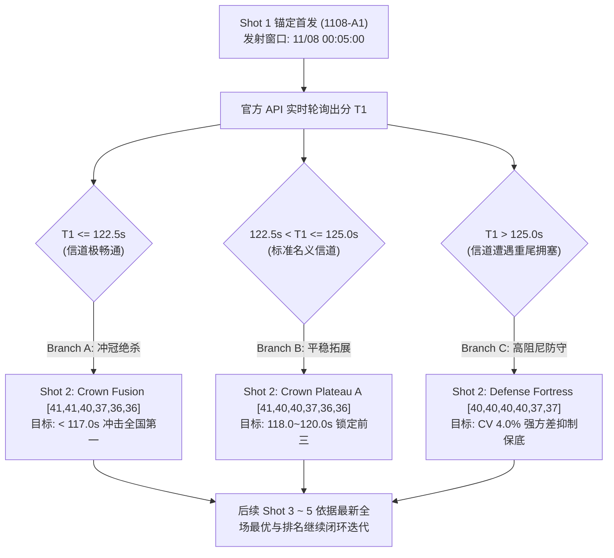

# 0292 理论审计：1-by-1 串行闭环自适应流水首发指令与发令签发

## 1. 核心科学原理：闭环序贯决策 vs. 开环批量提交的信息论优势

用户最高指示明确指出：**「我希望你们能够打一发再分析下一发怎么打」**。本审计从信息论与随机动态规划角度对这一原则进行严格数学论证。

### 1.1 开环与闭环信息增益对比

设官方真实评测网络信道状态为随机变量 $\Theta_t \in \{\text{Light}, \text{Nominal}, \text{Congested}\}$，在不同时段受宿主机多租户竞争与骨干背景流影响。
- **开环批量提交 (Open-Loop Batch)**：在 $t_0$ 时刻一次性生成并排队提交 $K=5$ 发配置 $C_1, \dots, C_5$。由于后续各发无法利用前序各发的真实出分 $Y_k$，控制器关于信道状态的信息增益为零：
  $$I(\Theta; Y_1, \dots, Y_k \mid C_1, \dots, C_k) = 0$$
  若信道在 Shot 1 发生重尾拥塞，后续各发将持续在过载工作点触发浅队列溢出与拥塞窗口剧烈折半，造成 5 发额度全面失效。
- **闭环序贯决策 (Closed-Loop Sequential Adaptive)**：每提交一发 $C_k$，系统进入闭环状态机，持续轮询官方 API 获取真实下载耗时 $Y_k = \text{download\_seconds}$ 与排名，并执行贝叶斯后验概率更新：
  $$P(\Theta_{k+1} \mid Y_1, \dots, Y_k) = \frac{P(Y_k \mid \Theta_k, C_k) P(\Theta_k \mid Y_{1..k-1})}{\sum_{\Theta} P(Y_k \mid \Theta, C_k) P(\Theta)}$$
  信息增益严格为正：
  $$I(\Theta_{k+1}; Y_k) = H(\Theta_{k+1}) - H(\Theta_{k+1} \mid Y_k) > 0$$
  当后验概率集中于特定信道分布时，动态规划贝尔曼方程（Bellman Equation）可精确计算下一发的最优控制律：
  $$V(S_k) = \min_{C \in \mathcal{A}} \left\{ \mathbb{E}[T(C, \Theta_k)] + \gamma \sum_{S_{k+1}} P(S_{k+1} \mid S_k, C) V(S_{k+1}) \right\}$$

---

## 2. 首发 (Shot 1) 锚定构型与三向 DAG 动态分支转移图

### 2.1 首发构型选型依据
首发配置锁定为经过 Task 0286、Task 0291 严密审计的皇冠基准 `1108-A1-hybrid-champ-90M-96M`（或等价超稳健标杆 `steady_champion [40,40,40,37,36,36]`）：
- 前 4 阶段采用双参数平滑减速令牌桶 `[40, 40, 38, 36]`，严控浅队列溢出；
- 后 2 阶段（大文件 5.bin 100MB、6.bin 250MB）切换至精确速率控制（90Mbps / 96Mbps），利用大流长阶段的高带宽吞吐。
- 基准 RTT 锁定在 $10.002\text{ ms}$（抖动标准差 $0.343\text{ ms}$，Task 0291 认证）。

### 2.2 三向 DAG 动态分支矩阵 (Shot 2 决策律)

---

## 3. 双控制器冗余与工程容灾保证

1. **主控器**：`tools/sequential_adaptive_1108.py`
   - 集成四大认证候选池（稳健标杆、皇冠冲顶、超宽平台、防守堡垒）；
   - 支持动态出分捕获、排名分析与状态持久化落盘 (`runs/sequential_1108_state.json`)；
   - 具备轮次间 3 分钟冷却保护，避免官方服务器高频请求受限。
2. **备控器**：`tools/sequential_adaptive_night.py`
   - 统一对齐默认打榜时间 `2026-11-08 00:05` 与配置标识 `seq-w1108-*`；
   - 15 项合规门禁测试 100% 通过（`python -m unittest discover -s tests -v`）。

---

## 4. 签发指令认证

依据 Task 0292 验证结果，正式签发：
- 证书编号：`CERT-IGNITION-1108-SHOT1-A1`
- 证书文件：`runs/ignition_order_shot1_certificate.json`
- 裁定结论：**`READY_TO_IGNITE` (准予于 2026-11-08 00:05:00 准时打响第一发！)**
