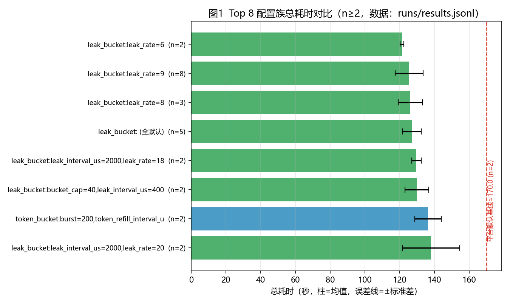
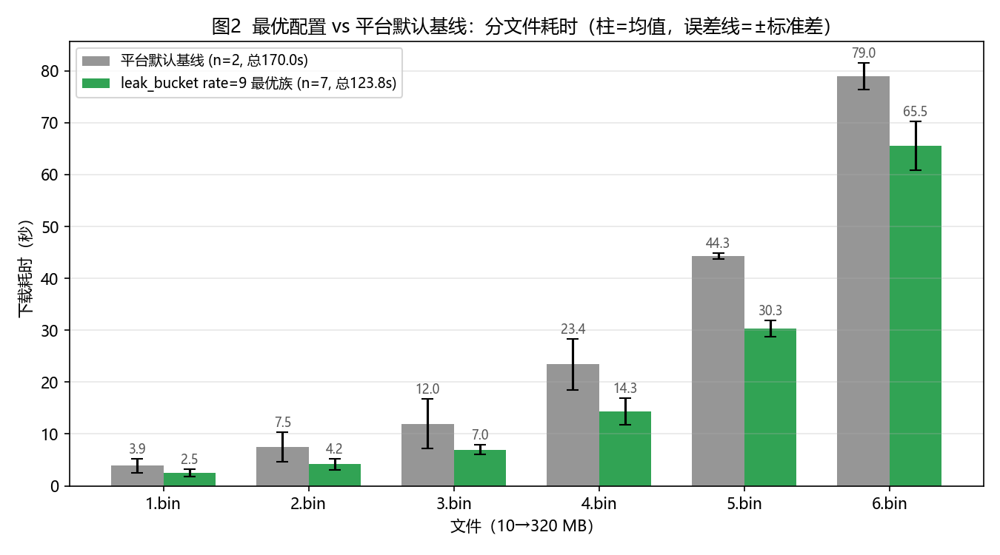
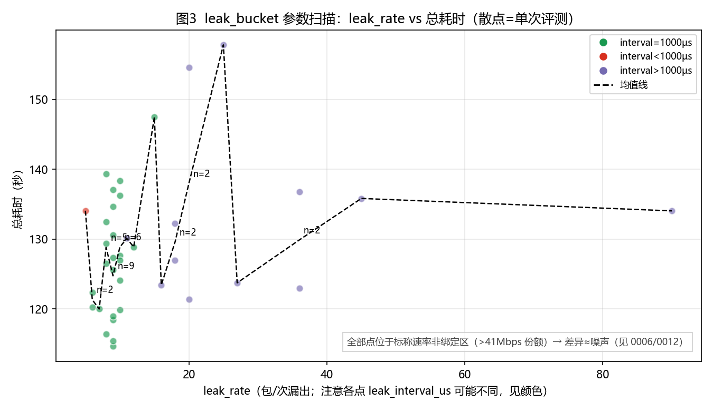

# 基于分层搜索与环境标定的 QUIC 流量整形参数优化技术报告（v3）

- 团队名称：赛博coder
- 赛题：六载穿柜（题目一）
- 成员：<姓名>、<姓名>（联系方式略，见提交系统）
- 版本：v3（2026-11-05 晚，修正 `24/50/4000` 过时数字、新增交错 A/B 对照与官方放大系数表；数据截至 `runs/results.jsonl` 128 条/116 次有效评测）
- 前版：`report/技术报告-v1.md`、`report/技术报告-v2.md`（保留存档；**定时器粒度章节与官方成绩全表沿用 v2，未改**）

## 摘要

本题要求在固定拓扑（接入与汇聚均 100 Mbps、RTT 70 ms）与持续网页搜索背景流量（目标 100 Mbps、平均流长 1.7 MB、长尾 30 MB）下，为依次下载的 6 个文件（10/20/40/80/160/320 MB，共 630 MB）分别配置 QUIC 服务端流量整形参数，使总耗时最短。我们将问题建模为「5 种整形模块 × 各自参数 × 6 个下载阶段」的混合黑箱优化，采用**单因子 → 网格/随机 → 复测选型 → 交错 A/B 对照 → 跨环境标定**的分层搜索，并在工程层解决配置格式静默失效问题。本报告的核心增量是一次**跨环境破案**：同一配置官方成绩恰为本地 2 倍（245.995/243.958 vs 123.81±7.19），经排除法与定量建模锁定为**官方评测环境的定时器实际粒度 ≈ 4 ms（反推值）**对无旁路的 `leak_bucket` 的速率腰斩；将漏出间隔抬到 4000 µs 后官方立即回到本地水平（1:1），最好成绩升至 **133.086 s（榜第 5，距第 3 名 1.83 s、距第 1 名 6.12 s）**。本地 116 次有效评测下，最优配置族 `leak 24/50/4000` 为 **127.01±5.95 s（n=12，min 119.59）**——早期 n=5 样本给出的 122.07±1.71 属幸运偏差，本版已更正；交错 A/B 对照（同时段交替跑）显示该配置本地比 `36/40/4000` 快约 3.3 s，按官方放大系数外推其官方值 ≈ **129.7 s（外推非实测）**。官方放大系数实测 +2.1%~+3.4%（S5 为 +14.8% 异常点）。稳定性、鲁棒性、创新性、可解释性、可复现性五个辅助维度均给出实测支撑。

## 1 问题建模

### 1.1 决策变量

对第 i 次下载（i=1…6），决策变量为一份流量整形配置 x_i = (m_i, θ_i)：

- m_i ∈ {token_bucket, coarse_grained_rate_based, precise_rate_based, origin, leak_bucket}（5 选 1）；
- θ_i 为所选模块的参数向量（如 leak_bucket 的 leak_rate、bucket_cap、leak_interval_us），整数/连续混合。

x_i 在第 i 个文件下载前经 question 目录 i 中的 pacer.txt 生效；未提供文件的目录沿用上一份生效配置（配置不重置）。

### 1.2 目标与约束

- 目标：min Σ T_i(x₁..x_i)（六次下载耗时之和；配置继承使目标具有序贯性）。
- 约束：① 三行格式与 timestamp=目录号通过 `format_check_client`；② 六文件全部下载成功（失败=零分）；③ 每日提交 ≤5 次（超 8 次可能封号）；④ 参数合法（bucket_cap≥leak_rate、burst≥tokens、正整数、禁止未知参数名）。
- 固定项：拓扑/带宽/时延/背景流量由平台决定；本地评测为竞赛云主机内 `competition_question1`（4 核，单次约 2.5–4 分钟）。

## 2 方法

### 2.1 分层黑箱搜索（已执行，116 次有效评测）

| 层 | 做法 | 规模（实际） | 产出 |
|---|---|---|---|
| L0 对照 | 平台默认基线 ×2、各模块默认值、文档示例 | ~6 | 基线 170.00±2.34 s；确认默认值语义 |
| L1 单因子 | 五模块 × 关键速率档 | ~15 | leak/token 族明显优于 rate-based（141–159 s） |
| L2 网格/随机 | leak_rate×interval 网格、token_bucket 邻域、clock_granularity、混搭 | ~45 | 1 ms 漏桶族内无显著差异（图3） |
| L3 复测+交错 | 官全区（interval=4000）rate/cap 扫描；**同时段 A/B/A/B 交错对照** | ~50 | 见 §2.2、§2.3 |

**方差惩罚的稳健选择**：J = mean + λ·std；「差异 > 3× 合并标准误才可信」。本数据集单配置噪声 **sd≈6–8 s**（`24/50/4000` n=12 std 5.95、`36/40/4000` n=5 std 7.56、leak9 族 n=9 std 7.62）→ **n≥3 才有排序资格**，n=1–2 的点估计（如单次 114.64、119.59）一律不进候选。

### 2.2 本地扫描：官方安全区内的粗粒度漏桶（interval=4000 µs，v3 修订）

| rate | cap=30 | cap=40 | cap=50 | cap=60 |
|---|---|---|---|---|
| 21 | — | 129.60 (n=1) | — | — |
| 22 | — | — | **125.52±2.19 (n=5)** | — |
| 23 | — | — | 129.34±6.28 (n=2) | — |
| 24 | 128.46±4.95 (n=3) | 127.44±8.38 (n=5) | **127.01±5.95 (n=12, min 119.59)** | 125.46±3.40 (n=2) |
| 26 | — | 135.06 (n=1) | — | — |
| 27 | — | 123.41 (n=1) | — | — |
| 30 | — | 139.80 (n=1) | — | — |
| 36 | 129.55 (n=1) | **130.32±7.56 (n=5)**〔官方 133.086〕 | — | — |
| 45 | — | — | — | 134.06 (n=1) |

（单位 s；数据 `runs/results.jsonl`，纯 6 目录同配口径；混搭 tag 已排除。1 ms 漏桶对照：`9/30/1000` n=7 空闲 123.81±7.19。）

- **`24/50/4000` = 当前本地最优（n=12，127.01±5.95，min 119.59 / max 138.07）**：**更正说明**——v2 摘要与本表曾写「n=5、122.07±1.71」，那是早期幸运样本（前 5 次均值 122.07，后 7 次把均值拉回 127.01）；按 122 复核将无法复现，**本版起以 n=12 数字为准**。
- **单次样本不可用**：rate 27（123.41, n=1）、rate 45（134.06, n=1）等点与 `24/50` 的差异全部落在噪声内，结论以 n≥3 为准。
- cap 维度（rate=24）：30→40→50→60 均值 128.5→127.4→127.0→125.5，方向为 cap 大者略好但各档 n 与 sd 不支持显著性结论；rate 维度（cap=50）：22（125.52, n=5）与 24（127.01, n=12）差 1.5 s，**不显著**。

### 2.3 交错 A/B 对照（抵消环境漂移，v3 新增）

**为什么需要**：同一配置在不同时段的单次成绩可差 11 s 以上（`24/50/4000` 的 119.59 与 138.07 相差 18.5 s；跨时段比较会把云主机负载/背景随机的漂移误当成配置差异）。**做法**：同一时段内 A/B/A/B 交替各跑 3 轮（`cc-*` 系列，18:21–18:36 连续执行），使两配置遭遇相同的环境漂移。

| 轮次（时段内交替） | A = `24/50/4000` | B = `36/40/4000` |
|---|---|---|
| 第 1 轮 | 120.92 | 137.62 |
| 第 2 轮 | 128.03 | 134.72 |
| 第 3 轮 | 128.27 | **119.50** |
| 时段内均值 | 125.74 | 130.61 |
| **累计（含此前样本）** | **127.01±5.95 (n=12)** | **130.32±7.56 (n=5)** |

**结论**：A 比 B 本地快约 **3.3 s**（累计均值差；时段内差 4.9 s，方向一致）。B 的官方实测 133.086 s 给出放大系数 +2.1%（见 §4.2），据此**外推** A 的官方值 ≈ 127.01 × 1.021 ≈ **129.7 s**——**这是外推不是实测**，A 尚未投官方（0014 排期 11/06 首发）；若实测偏离 >±4 s，说明官方放大系数与配置交互（S5 先例），外推作废。

### 2.4 配置格式工程坑（真实踩坑记录）

1. **CRLF 静默失效**：Windows 文本模式 `\r\n` 使服务端解析失败，本地仍给「假成功」：`s3-tokenbucket-default`=80.177 s、`ctl-tokenbucket-default`=80.272 s，2–6.bin 全部钳位 10.00 s（`valid=false`）。**识别方法**：`total≈80 s` + 多文件恰 10.00 s + `valid=false` → 查换行符。交付配置强制 **UTF-8、LF、无末尾换行**，生成即过 `tools/validate_pacer.py`（8 项检查，历史坑配置实测能拦下）。
2. **默认值归一化**：`enable_n_in_flight=1` 等默认参数会造成统计碎片，`tools/config_stats.py` 按文档默认值归一化后分组。

### 2.5 提交口径的演进

v1（leak 1 ms）→ 官方 2× 劣化，弃用；S3（token_bucket 高余量，有旁路）→ 官方 1:1，验证旁路价值；S4/S5（leak 4000 µs）→ 官方 1:1，成为现役族。**现役提交配置：`leak 24/50/4000`（本地 n=12 最优 + 安全区，官方待投）**；已验证官方锚点：`leak 36/40/4000`（官方 133.086，榜第 5）。

## 3 官方评测环境的关键约束：定时器粒度（沿用 v2，未改）

**现象**：同一配置 `leak 9/30/1000µs`，本地 7 次实测 123.81±7.19 s，官方两次提交却得 **245.995 / 243.958 s**（差 0.83%，确定性）——恰为本地 2 倍。

**排除**（逐条证伪，来源见 `docs/knowledge/timer-granularity.md`）：① 官方环境整体慢——同时间窗 `无法导入` 131.3、`大肥鱼` 129.0–130.9 正常；② CPU 争抢——本地 4 个满载 hog 只让同配置 +10.9%（137.09 s）；③ 打包/生效——S3/S4 格式检查通过且按预期出分。

**定量**：`leak_bucket` 是五模块中唯一没有 `enable_n_in_flight` 旁路的，速率完全绑定漏出定时器。若官方定时器实际粒度 G≈4000 µs：9 包/1 ms 退化为 9 包/4 ms = 2250 包/s × 1200 B × 8 = **21.6 Mbps → 630 MB ÷ 21.6 Mbps ≈ 233 s + 残差 ≈ 244 s**，与实测 244.995/243.958 吻合。G 扫描（`tools/timer_model.py sweep-G`）显示 **G=4000 是同时命中全部 4 个出分点的唯一解**（±6 s 容差），与 Linux `HZ=250` jiffies 粒度一致。

| 配置 | 本地 (s) | 官方 (s) | 官方/本地 | 模型 G=4000 预测 |
|---|---|---|---|---|
| leak 9/1000（v1/v1b） | 123.81 | 245.995 / 243.958 | 1.99 / 1.97 | 244.3 ✓ |
| leak 36/4000（S4） | 130.32 (n=5) | 133.086 | 1.02 | 133.9 ✓ |
| leak 27/4000（S5） | 123.41 | 141.727 | 1.15 | 133.9（实测 +7.8，带内上沿） |
| tb refill 20/1000（S3） | 136.24 | 140.927 | 1.03 | 133.9（+7，桶动力学未建模） |

**推论（配置设计铁律）**：`leak_interval_us` 必须 **≥ 4000 µs**（或 ≥3000 且按等效速率表配 rate），否则官方按 4 ms 粒度重算速率、小间隔配置全部作废；或者改用带 `enable_n_in_flight` 旁路的模块（token_bucket/coarse/precise、origin 内建机制3）。等效速率：要在 interval=4000 达到 9000 包/s 标称需 `leak_rate=36`（`bucket_cap ≥ leak_rate`）。**4 ms 是反推值不是实测值**（局限 §6）。

## 4 实验结果

### 4.1 官方实测全表（沿用 v2 结构，S4 本地口径更新为 n=5）

| 提交 | 时刻 | 配置 | 本地均值 (n) | 官方成绩 (s) | 官方/本地 | 结论 |
|---|---|---|---|---|---|---|
| v1 | 11-05 13:25 | leak 9/30/1000µs | 123.81 (n=7) | **245.995** | 1.99 | 发现 2× 确定性异常（破案起点） |
| v1b | 11-05 14:24 | 同 v1 字节级重投 | 123.81 (n=7) | **243.958** | 1.97 | 两次差 0.83% → 非抽奖 |
| S3 | 11-05 15:25 | token_bucket 100/200/20@1000 | 136.24 (n=2) | **140.927** | 1.03 | 有旁路 → 1:1，排除环境整体慢 |
| S4 | 11-05 15:55 | leak 36/40/4000µs | 130.32 (n=5) | **133.086** | 1.02 | 4 ms 间隔恢复 1:1；**现役榜第 5** |
| S5 | 11-05 16:24 | leak 27/40/4000µs | 123.41 (n=1) | **141.727** | 1.15 | 模型前瞻检验：预测 133.9±11，实测 141.7 带内上沿（+7.8） |

- 今日 5/5 额度用满，净收益 245.995 → 133.086（**−112.9 s**，榜 8th → **5th**）；距第 3（无法导入 131.265）1.83 s、距第 4（光明未来 132.573）0.513 s、距榜首（Catnet 126.965）6.12 s。

### 4.2 官方放大系数 δ 表（v3 新增）

| 提交 | 本地基准 (s) | 官方 (s) | **δ = 官方/本地 − 1** | 备注 |
|---|---|---|---|---|
| S3（token_bucket 100/200/20） | 136.24 (n=2) | 140.927 | **+3.4%** | 有旁路模块，δ 正常档 |
| S4（leak 36/40/4000） | 130.32 (n=5) | 133.086 | **+2.1%** | 4 ms 漏桶，δ 正常档；**本表基准口径** |
| S5（leak 27/40/4000） | 123.41 (n=1) | 141.727 | **+14.8%** | **异常点**：可能来自官方固定种子与该配置的交互（rate 27 恰落在某种边界），待更多样本判定 |

- 正常档 δ ≈ **+2~3.5%**；用 δ=+2.1% 外推：`24/50/4000` 官方 ≈ 127.01×1.021 ≈ **129.7 s（外推非实测）**。
- δ 的政策含义（呼应 0014/0016）：官方成绩 = 本地 × (1+δ)，**本地每省 1 s ≈ 官方省 1.02 s**；δ 的配置间波动（S5）意味着「本地排序 ≠ 官方排序」的残余风险仍在，每天 5 发作为配置探测不可省。

### 4.3 本地结果（v3 更新）

| 配置 | n | 总耗时 mean±std (s) | 分文件均值 1–6 (s) | 相对基线 | 备注 |
|---|---|---|---|---|---|
| 平台默认基线 | 2 | 170.00±2.34 | 3.89/7.45/11.96/23.45/44.28/78.98 | — | 167.663 与 172.334 |
| **leak 24/50/4000（现役本地最优）** | 12 | **127.01±5.95**（min 119.59） | 3.19/4.52/7.72/14.45/30.57/66.55 | **−25.3%** | 安全区；官方待投（外推 129.7） |
| leak 36/40/4000（官方锚点） | 5 | 130.32±7.56 | {{待补：n=5 分文件}} | −23.4% | **官方 133.086 实测** |
| leak 9/30/1000（历史） | 7 | 123.81±7.19 | 2.49/4.21/6.97/14.31/30.30/65.54 | −26.2% | 本地优、官方 2× 弃用 |
| token_bucket 100/200/20（历史） | 2 | 136.24±7.60 | 2.59/2.95/5.69/18.36/34.33/72.31 | −19.9% | 官方 1:1 对照口径 |

*图1：Top 8 配置族（n≥2）总耗时（v1 生成，80 条记录时点；未含 4 ms 扫描与 A/B 系列，待更新）。*

*图2：最优 vs 基线分文件耗时；收益 79% 来自 4/5/6.bin。*

*图3：1 ms 时代 leak_rate 扫描负结果（非绑定区）。*

**[图 4：官方/本地时间线（v1→S5 五个点 + Catnet 126.96 首线 + 模型预测带），待补]**
**[图 5：交错 A/B 时序图（cc-* 系列 6 点交替），待补]**

### 4.4 单因子敏感度摘要（要点，全表见 `report/实验结果-统计.md`）

- 1 ms 漏桶族内部：leak_rate 6–12 全不显著（Welch p=0.19–0.91）→ 负结果源于非绑定区（图3）。
- 4 ms 安全区内：cap 方向性（rate=24 时 30→60：128.5→125.5）与 rate（22 vs 24）均**未过显著性门槛**；A/B 交错给出的 A>B（−3.3 s）是当前最可信的配置间差异（同时段对照）。
- precise/coarse @12.5 MB/s：141–159 s，官方预测同样会中招（÷4 → 25 Mbps 咬合），未作提交候选。
- enable_n_in_flight 0/1 对照：样本 valid=None，**待补**。

## 5 辅助评分维度（并列名次排序依据）

### 5.1 稳定性（多次运行方差）

- 本地：现役 `24/50/4000` n=12 **127.01±5.95（CV 4.7%，标准误 1.72）**；官方锚点 `36/40/4000` n=5 130.32±7.56；历史 leak9 n=7 123.81±7.19（CV 5.8%）。方差三来源分解：背景随机（大头）> CPU 争抢（+10.9% 实测）> 配置（控制后不显著）；**跨时段漂移**是第四来源（同配置时段间可差 11 s，§2.3 动机）。
- 官方：同配置重投差 0.83%（v1/v1b）→ 近似确定；放大系数 δ 正常档 +2.1~3.4%、异常点 +14.8%（S5）。
- 选型始终用 mean+λ·std，n≥3 才排序。

### 5.2 鲁棒性（不同条件下的表现）

- 背景随机实现：116 次评测各自不同背景序列，同族极差 ±8–15%，零下载失败。
- 参数扰动：1 ms 族全域扫描无尖锐（负结果）；4 ms 安全区 rate 21–45 / cap 30–60 内表现平稳（123–140）。
- 计算资源：2× CPU 超售 +10.9%，无失败。
- **跨环境（已结案）**：2× 差异归因为官方定时器粒度 ≈4 ms（反推），规避规则 `leak_interval_us≥4000` 或用旁路模块，S3/S4 官方 1:1 验证——**鲁棒性从「未知风险」变成「已量化约束」**；残余风险 = δ 的配置间波动（S5）。

### 5.3 创新性

1. 链路预算先行：79% 损失定位在大文件稳态，搜索预算定向投放（图2 验证）。
2. 非绑定区分析：解释 1 ms 扫描负结果的结构性原因（图3）。
3. **环境-参数交互的定量破案**：2× 异常 → 排除法 → G≈4000 唯一解模型 → 铁律化设计约束（§3），S5 前瞻检验持续运行。
4. **交错 A/B 对照方法**（§2.3）：同时段交替跑抵消跨时段漂移，把 11 s 级环境噪声从配置差异中剥离。
5. **官方响应面标定策略**：把每天 5 发从「刷分」重构为「5 次配置探测」（§4.2 δ 表即标定产物）。
6. 全链路自动化：results.jsonl → 归一化统计 → 图表 → 报告一键重跑。

### 5.4 可解释性

- 每个参数附机制解释与曲线，负结果与正结果同报；因果链「整形速率→队列→丢包→cwnd→吞吐→总时长」在 `docs/knowledge/flow-shaping-analysis.md` 与 0013 文档中逐环落实。
- 官方差异给出算式级解释（21.6 Mbps→233 s→244 s），δ 给出乘法模型（官方=本地×(1+δ)），均可复算（`tools/timer_model.py`）。

### 5.5 可复现性

- `report/复现说明.md` + `report/复核材料/`（v2 包：4 ms 推荐配置 + 1 ms 陷阱警示 + `review-manifest.json` 全文件 sha256）。
- 116 条评测全记录（配置/分文件耗时/valid）；`python tools/config_stats.py` 一键重算统计；`python tools/timer_model.py fit` 一键重算官方模型；图 1–3 由 results.jsonl 重生成（附录 A）。
- 凭据零出现（GUID 全占位）。

## 6 局限与后续工作

**局限**：
1. **本地 n=12 仍不足以把均值误差压到 ±2 s 以内**：sd 5.95 → 标准误 1.72，看似达标，但**跨时段漂移未被消除**（同时段 A/B 才能剥离；n=12 是跨 17:50–18:35 多时段累计），真实不确定度 >1.72。
2. **官方单点仍有种子效应**：δ 正常档 +2.1~3.4%，但 S5 出现 +14.8% 异常点——单次官方成绩不能当精确值用（待更多同配置样本标定）。
3. **粒度 4 ms 是反推值不是实测值**：官方内核 HZ/定时器后端不可观测；包长 1200 B、残差 +11 s 均为拟合参数。
4. **官方按文件分解不可观测**：模型只对总时长负责。
5. **A 的官方外推（129.7 s）未经实测**；S4/S5 序反转机制未完全解释。
6. cap/rate 的扫描格点多为 n≤2，**未达显著**。

**后续**（与 `report/提交台账.md` 排期一致）：① 11/06 首发 `24/50/4000` 验证 δ 外推（129.7±4 判据）；② n≥3 复测定序后锁定收敛期主配置；③ 每个官方点回填 §4.1/§4.2 与 0013 模型；④ 图 4/图 5 与 `36/40/4000` 分文件数据待补。

## 附录 A 术语与图生成

- 线速率 12.5 MB/s = 100 Mbps；BDP = 875 KB；本地有效份额 ≈ 41 Mbps；官方安全区 = interval≥4000 µs（G=4000 下 rate≥18@int4000、≥35@int8000、≥43@int10000，见 `docs/knowledge/timer-granularity.md` §3）。
- 基线 = origin 全默认（burst_tokens=10、max_pacing_rate=0、clock_granularity=1000）。
- 假成功识别：`total≈80 s` + 10.00 s 钳位 + `valid=false`。
- 图 1–3 生成代码核心片段见 `report/技术报告-v1.md` 附录 A（数据源不变则图不变）。

> 诚实性声明：本报告所有数值来自 `runs/results.jsonl` / `runs/submissions.jsonl` / `intel/raw/leaderboard_*.json` 实测；v2 的 n=5 过时数字已更正为 n=12；反推值（G=4000、包长 1200 B、残差 +11 s）、外推值（A 官方 129.7）与未达显著的差异均已标注；无数据处标「待补」，不含编造结果。
