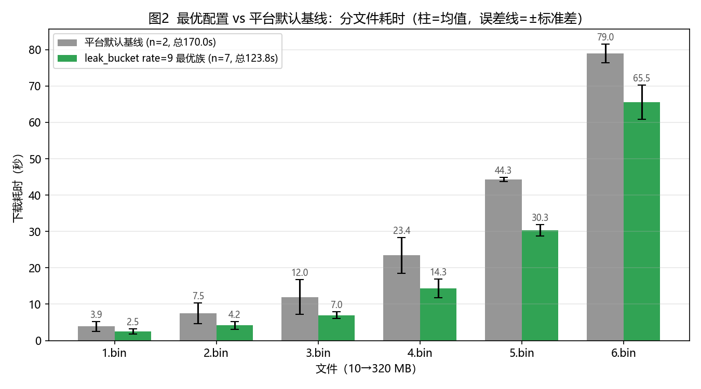
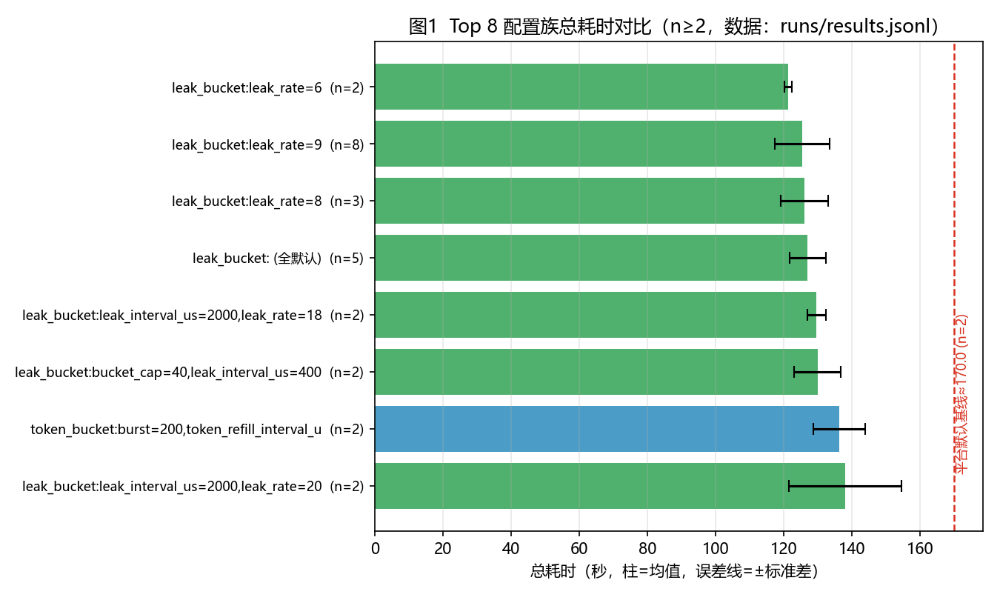
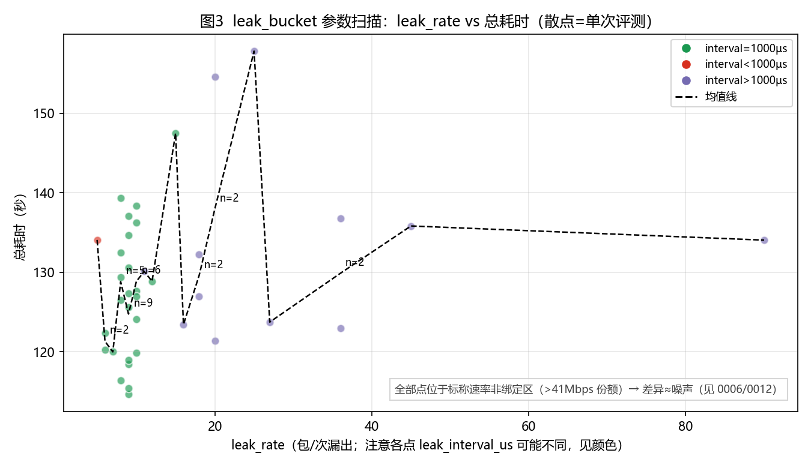

<!-- _class: lead -->
<!-- _paginate: false -->

# 六载穿柜：流量整形参数优化

**赛博coder** · 智能领域定制网络 iDSN 挑战赛

- 630 MB 六文件顺序下载 × 100 Mbps 共享链路
- 本地 **170.0 → 127.0 s**（−25.3%，n=12）
- 官方 **133.086 s，榜第 5**（距第 1 名 6.12 s）

答辩：2026-11-20~22 · 厦门

---

# 问题背景：夹缝中取数

- 六文件 10→320 MB **必须顺序**下载，单连接、不可并行
- 与网页搜索背景流**共享同一根 100 Mbps 上联**（背景目标速率也 = 100 Mbps）
- RTT 70 ms（BDP = 875 KB）；背景流长尾 30 MB、均值 1.7 MB
- 每次下载前可换一份 pacer 配置（5 模块 × 参数 × 6 阶段）

**难点**：谁在夹缝里抢到带宽、抢得稳不稳，就是全部分数

---

# 问题建模

- **决策变量**：6 份配置 x_i =（模块选 1 × 参数），写入 `question/i/pacer.txt`（目录无文件则沿用上一份）
- **目标**：六次下载耗时之和最小
- **约束**：格式合法（timestamp=目录号、参数白名单）｜六文件全部成功（失败=零分）｜每天 ≤5 次提交
- 固定项：拓扑 / 背景流量 / QUIC 栈由平台给定

---

# 实验平台与流水线

- 竞赛云主机 4 核：`format_check_client` → `competition_question1`（单次 2.5–4 min）
- **143 次有效评测**全记录：配置 + 分文件耗时 + valid（`runs/results.jsonl`）
- 统计一键复跑：`tools/config_stats.py`；官方模型复算：`tools/timer_model.py`
- 提交链路：本地校验 → 官方 format_check → `local_send_client`（额度 5 次/天）

---

# 瓶颈在哪：79% 损失在大文件

- 基线有效吞吐仅 **30 Mbps**（理论公平份额 50 Mbps）
- 小文件被握手 + 慢启动固定开销主导，优化空间 1–2 s
- 收益 **79% 来自 4/5/6 号大文件**（−36.6 s / 总 −46.2 s）→ 搜索预算全部投向大文件稳态

---

# 五模块与关键差异

| 模块 | 突发 vs 平滑 | `enable_n_in_flight` 旁路 |
|---|---|---|
| token_bucket | 桶突发 + 补充平滑 | ✅ 有 |
| origin（默认） | 突发 + 速率混合 | ✅ 机制3 内建 |
| coarse / precise | 按间隔卡时间 | ✅ 有 |
| **leak_bucket** | 固定节奏漏出 | ❌ **唯一没有** |

→ 漏桶完全绑定定时器 —— 这一行差异后来成了胜负手

---

# 方法：四层搜索 + 环境标定

1. **L0 对照**：基线 ×2、各模块默认值（170.00±2.34 s）
2. **L1 单因子**：模块 × 速率档 → leak/token 族胜出
3. **L2 网格**：rate × interval × cap 约 45 组
4. **L3 复测 + 交错 A/B**：同时段交替跑抵消漂移；**n≥3 才排序**（本地噪声 sd≈6–8 s）

工程坑：CRLF 换行 → 服务端解析失败、本地 80 s「假成功」→ 生成即过 `validate_pacer.py`（8 项检查）

---

# 破案：官方定时器粒度 ≈ 4 ms

- **现象**：同配置 leak 9/30/**1000µs**，本地 **123.81±7.19**，官方 **245.995 / 243.958**（差 0.83%）= 恰好 ×2
- **排除**：同窗他队正常（129–131）｜4 个 CPU 满载 hog 只 +10.9%｜格式检查通过
- **定量**：9包/1ms 在 4 ms 粒度 → 2250 包/s ≈ 21.6 Mbps → 630 MB ≈ 233 s + 残差 ≈ **244 s** ✓
- **G 扫描唯一解 G=4000 µs**（与 HZ=250 吻合，反推值）
- **铁律**：`leak_interval_us ≥ 4000` 或改用带旁路模块 → 官方立即 1:1

---

# 结果：官方实测五连发（今日 5/5）

| 提交 | 配置 | 本地 (n) | 官方 (s) | δ |
|---|---|---|---|---|
| v1 / v1b | leak 9/30/**1000** | 123.81 (7) | 245.995 / 243.958 | +96% ⚠陷阱 |
| S3 | token_bucket 100/200/20 | 136.24 (2) | 140.927 | +3.4% |
| **S4** | **leak 36/40/4000** | 130.32 (5) | **133.086** | **+2.1%** |
| S5 | leak 27/40/4000 | 123.41 (1) | 141.727 | +14.8% 异常 |

**榜第 5**：距第 3（131.265）1.83 s｜距第 4（132.573）0.513 s｜距第 1（**126.965**）6.12 s

---

# 结果：本地最优（143 次有效评测）

- 现役族 **`leak 24/50/4000`：127.01±5.95（n=12，min 119.59）**，比基线 −25.3%
- 交错三方（15 轮同时段）：`24/60` 均值 **121.6**、`22/50` 126.5、`24/50` 130.5
- **历史最好单次 112.361 s**（`24/60/4000`，其中 6.bin 仅 55.57 s）
- 更正记录：早期 n=5 的 122.07 属幸运样本，n=12 回归 127.01 —— 单点不可信
- 数据源：技术报告-v3 + hourly 2026-11-05_2000（121.6 / 112.36 为 v3 截止后的新增实测）

---

# 负结果：参数扫描没有梯度

- 1 ms 时代：leak_rate 6→12 全不显著（p=0.19–0.91）
- **原因**：标称速率 69–138 Mbps ≫ 实际份额 41 Mbps → 整形器**非绑定**，测的全是背景随机
- cap 维度同样无单调（60→120：122–131 乱跳）
- **结论**：负结果也是结果 —— 转向「绑定区设计 + 跨环境标定」，不给噪声梯度交学费

---

# 稳定性与鲁棒性

- **稳定性**：n=12 CV 4.7%（标准误 1.72）；方差三来源 = 背景随机 > CPU 争抢（+10.9% 实测）> 配置（不显著）；跨时段漂移用**交错 A/B** 剥离
- **官方侧**：同配置重投差 0.83%（近似确定）；δ 正常档 **+2.1~3.4%**、异常点 +14.8%（S5，种子×配置交互待裁决）
- **跨环境**：2× 差异已从「未知风险」变成「已量化约束」（4 ms 铁律）
- **选型**：J = mean + λ·std，宁要平台点不要尖点（人工复测防过拟合）

---

# 可复现性

- `report/复现说明.md` + **复核材料包 v2**（5 配置、1 ms 陷阱警示、`review-manifest.json` 全文件 sha256）
- 143 条评测记录 + 配置原文（LF/无末尾换行，与 `runs/configs/` 字节一致）
- 一键链路：`config_stats.py`（统计）→ `timer_model.py`（官方模型）→ `official_analysis.py`（探测分析）
- 图表由数据重生成；凭据零出现（GUID 全占位）

---

# 局限与下一步

- **局限**：4 ms 是反推值｜官方按文件分解不可观测｜单点种子效应（δ 异常 S5）｜n=12 仍受跨时段漂移
- **11/06 起每天 5 发**：rate 22–26 / cap 40–60 的 2-D 标定（已排程），出分后 `official_analysis.py` 自动生成次日候选
- **停止条件**：15 个探测点仍 >129 → 弃一等保二等；11/15 未过 132.57 → 末日只投最稳配置
- 目标：一等 ≤126.965（差 6.12 s）｜二等 ≤131.265（差 1.83 s）｜三等 ≤132.573（差 0.49 s）

---

<!-- _class: lead -->
<!-- _paginate: false -->

# 谢谢聆听

**赛博coder** · 六载穿柜

- 方法：链路预算 → 四层搜索 → 环境标定
- 本地 170 → 127 s；官方 133.086 s（榜第 5）
- 全部数据可复现，欢迎提问

**Q & A**

---

<!-- _class: appendix -->
<!-- _paginate: false -->

## 附录：逐页讲稿（打印用，不放映）

**P1 封面**：各位评委好，我们是赛博coder。我们的赛题是六载穿柜：六份从 10 到 320 MB 的数据必须依次取回，全程只有一根 100 Mbps 的共享上联。我们用链路预算指导的参数搜索，把本地总耗时从 170 秒压到 127 秒，官方成绩 133.086 秒、目前第 5。

**P2 背景**：场景很生活化：训练集群取模型分片，六个文件一个比一个大一倍；同一时间搜索查询一直在同一根汇聚链路上跑，目标速率恰好也是 100 Mbps——它一家就想吃满整条链路。背景流长尾到 30 MB，多数流只有几 KB，典型「短流夹长流」，我们得在夹缝里抢带宽。

**P3 建模**：我们把问题形式化成黑箱优化：每次下载前改一份配置，五模块选一、参数随便填；目标是六次耗时之和最小；硬约束是格式合法、六文件全部成功——任何一条不满足，这次提交就是零分。配置还是继承的，目录不放文件就沿用上一份。

**P4 平台**：评测在竞赛云主机里做：先格式检查再仿真，单次两三分钟。我们一共跑了 143 次有效评测，每次的配置、分文件耗时、是否有效全部记录在 jsonl 里——这是所有统计和图表的唯一数据源，每个数字都能溯源。

**P5 瓶颈**：先看基线：默认配置有效吞吐只有 30 Mbps，理论公平份额是 50。拆开耗时看，损失的 79% 集中在四五六号大文件；小文件被握手和慢启动的固定开销主导，只有一两秒可省。所以全部搜索预算投向大文件的稳态——这个判断后面被数据反复验证。

**P6 五模块**：五个模块的差别本质是「怎么控速」：漏桶定速漏包、令牌桶攒令牌放行、速率型按间隔卡时间、origin 是混合再加旁路。注意一个细节——漏桶是五个里唯一没有旁路的，完全依赖定时器，这一行差异后来成了胜负手。

**P7 方法**：方法是四层：对照、单因子、网格、复测选型，评价函数是均值加方差惩罚，差异超过三倍标准误才算数。我们还做了同时段交错 A/B 来抵消环境漂移。踩过的坑是 CRLF 换行——服务端解析失败但本地出 80 秒假分，现在生成即校验。

**P8 破案**：这是今天最关键的发现：同一份漏桶配置，本地 123.8 秒，官方却是 245.995 和 243.958——正好两倍。我们排除了环境慢、CPU 争抢、打包问题，最后定量锁定：官方定时器实际粒度约 4 毫秒，9 包每毫秒被拉成 9 包每 4 毫秒，速率掉到 21.6 Mbps，630 兆除下来正好 233 秒加残差等于 244。把漏水间隔抬到 4000 微秒，官方立刻回到本地水平。

**P9 官方成绩**：今天五发全部打完：前两发是踩坑的 1 毫秒配置，245/244；第三发换带旁路的令牌桶，140.9；第四发 4 毫秒漏桶，133.086——目前第 5；第五发 141.7 是模型的前瞻检验，落在预测带内上沿。放大系数正常档是加 2% 到 3.4%。

**P10 本地最优**：本地 143 次评测里，现役族 24/50/4000 是 127.01 加减 5.95，n 等于 12；交错三方实验里 24/60 均值 121.6，还跑出历史最好 112.361 秒、六号文件只要 55.57 秒。要诚实说的是：早期 n=5 的 122 是幸运样本，样本一多就回归到 127——单点不可信，这是我们反复强调的。

**P11 负结果**：这张散点图是我们最有价值的负结果：参数扫描毫无单调性，统计上全不显著。原因是这些配置的标称速率都远高于实际能拿到的 41 Mbps，整形器根本没咬合，测出来的全是背景随机。知道路走不通比硬走更重要——我们因此转向绑定区设计和跨环境标定。

**P12 稳定鲁棒**：稳定性上，n=12 的变异系数 4.7%；方差来源我们分解过：背景随机是大头，CPU 争抢实测只值 11%，配置本身控制后不显著。官方侧同配置重投只差 0.83%，近似确定；跨环境的两倍差异已经从未知风险变成量化的 4 毫秒铁律。选型用均值加方差惩罚，宁要平台点不要尖点——因为 top 提交会被人工复测。

**P13 复现**：复现是傻瓜式的：统计一条命令、官方模型一条命令、探测分析一条命令；143 条记录和全部配置原文都在仓库里，复核材料包带全文件哈希清单；凭据全部占位，材料可以直接交给复核方。

**P14 局限**：局限讲三点：4 毫秒是反推值、官方按文件分解拿不到、单点还有种子效应。下一步从明天起每天五发改 2-D 标定设计，出分后工具自动生成次日候选；停止条件写死了——15 个探测点还进不了 129 就转保二等。目标：一等差 6.12 秒、二等差 1.83 秒、三等差 0.49 秒。汇报完毕，请各位评委批评指正。
